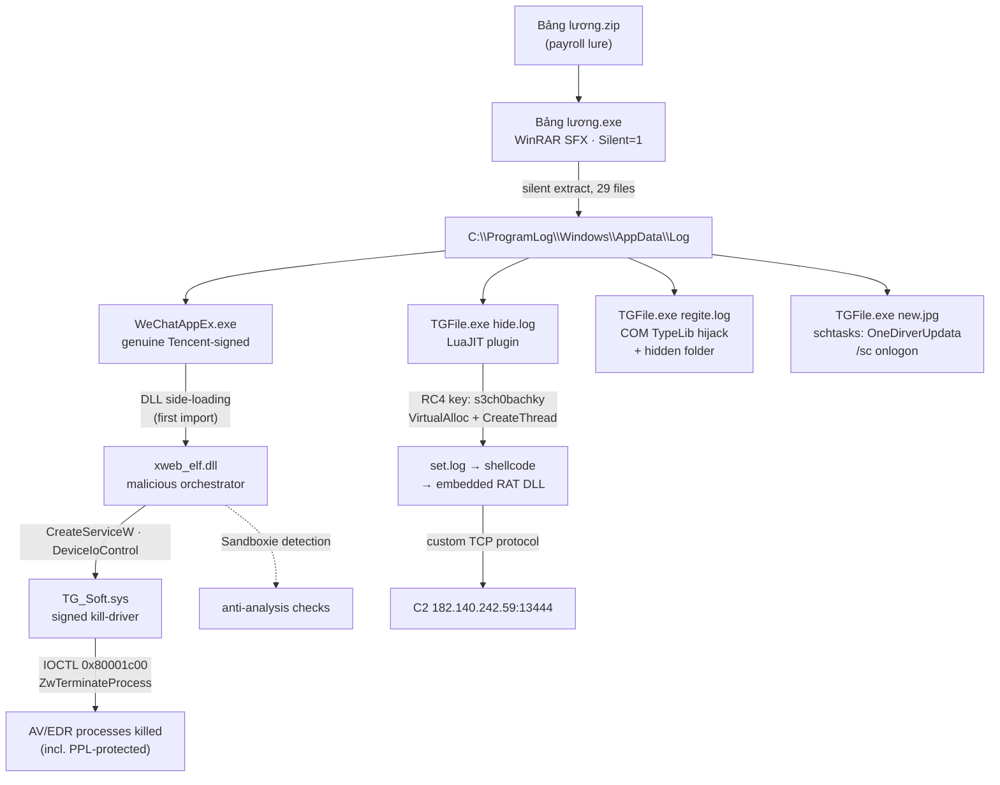

# 🇻🇳 "Bảng Lương" Payroll Malware — Full Static Analysis


> A Vietnamese payroll-themed ZIP (`Bảng lương.zip` — "salary sheet") delivering a WinRAR SFX dropper
> that deploys a full-featured RAT using **genuine vendor-signed binaries as cover**, a
> **kernel-mode EDR killer**, and a **LuaJIT plugin framework** — reversed end-to-end
> without executing a single byte.

---

## TL;DR

| | |
|---|---|
| **Lure** | `Bảng lương.zip` → `Bảng lương.exe` (WinRAR SFX, `Silent=1`) |
| **Drop path** | `C:\ProgramLog\Windows\AppData\Log` (fake AppData mimic) |
| **Loader** | Genuine **Tencent-signed** `WeChatAppEx.exe` sideloading malicious `xweb_elf.dll` |
| **Script runner** | **Sangfor-signed** `TGFile.exe` executing LuaJIT 2.1.0-beta3 plugins |
| **EDR killer** | `TG_Soft.sys` — custom kernel driver, `\Device\ProcKill`, kills any PID incl. PPL |
| **Main payload** | `set.log` = RC4-encrypted PIC shellcode (key: `s3ch0bachky`) wrapping a 318 KB RAT DLL |
| **Persistence ×3** | Scheduled task `OneDirverUpdata` + COM TypeLib hijack + scriptlet |
| **C2** | `182.140.242.59:13444` (TCP tunnel; leaked in the operator's own OpenVPN log) |
| **RAT capabilities** | Keylogger, screen capture, clipboard theft, file manager, shell, registry, **Windows event-log wiping** |
| **Operator** | Chinese-speaking (multiple native-language artifacts); toolchain consistent with the **Winos 4.0 / ValleyRat** cluster |

---

## Attack chain



**SFX auto-exec script** (recovered from the RAR comment, alongside a Chinese operator note
`;下面的注释包含自解压脚本命令` — "the comment below contains the SFX script commands"):

```text
Path=C:\ProgramLog\Windows\AppData\Log
Setup=WeChatAppEx.exe
Setup=TGFile.exe hide.log
Setup=TGFile.exe regite.log
Setup=TGFile.exe new.jpg
Silent=1
Overwrite=2
```

---

## The signature shell game

Every executable a user (or a naive reputation engine) would see is **genuinely signed by a trusted vendor**.
The malicious logic lives only in unsigned satellites:

| Component | Signer | Status |
|---|---|---|
| `WeChatAppEx.exe` | **Tencent Technology (Shenzhen)** — serial `ddaf2fe5…` | Genuine; unwitting sideloading host |
| `TGFile.exe`, `libepsbase.dll` | **Sangfor Technologies Inc.** — serial `9f980676…`, valid 2023→2026 | No version resources; both built 2025-07-19 |
| `libssh2.dll` | **AsiaInfo Technologies (Chengdu)** — serial `e3e33f20…`, valid to 2026-12 | Network support lib |
| `TG_Soft.sys` | **Anneng electronic Co. Ltd.** (Fuzhou) — serial `2602bb9b…`, Thawte, **valid 2013→2014** | Abused legacy cert; driver still loads on non-HVCI hosts |
| 11 runtime/system DLLs | **Microsoft** (genuine) | Decoy ballast / dependency padding |

> ⚠️ The Sangfor and AsiaInfo certificates were valid at analysis time. Vendors were notifiable
> of possible signing-process abuse. Treat *these specific file hashes* as malicious, not the vendors.

---

## The EDR killer — `TG_Soft.sys`

Not BYOVD in the classic sense: there is no CVE, no "vulnerable" driver — the kill capability
**is the driver**. 1 KB of `.text`, read in full manually:

```text
DriverEntry:  IoCreateDevice("\Device\ProcKill") + IoCreateSymbolicLink("\??\ProcKill")

IOCTL 0x80001c00   (FILE_DEVICE_UNKNOWN 0x22, function 7, METHOD_BUFFERED, FILE_ANY_ACCESS)
  input: 4-byte PID
  → ZwOpenProcess(PROCESS_ALL_ACCESS)
  → ZwTerminateProcess(handle, 0)
  → ZwClose
```

Build artifacts left in the binary:

- PDB: `D:\tools\驱动\MyDriver1-master\x64\Release\MyDrv1.pdb` (`驱动` = *driver*; `MyDriver1-master` = a downloaded GitHub starter template)

---

## Operator sloppiness (the analysis gifts)

- RAT DLL export named **`zidingyixiugaidaochuhanshu`** — pinyin for *“custom-modified export function”*
- Chinese dev comments inside the plaintext Lua plugin (`-- bInheritHandles: 用 0 而非 false`)
- **`vpncore.log`** — the operator's own OpenVPN client log shipped inside the payload, leaking the C2: `182.140.242.59:13444`
- Decrypted shellcode ends with an ASCII marker: **`dave`**
- Forged PE timestamps (2073, 2042, 1977, 2097…) on most files
- 1997-era Python demo scripts (`websucker.py`, `wsgui.py`, `readme.txt`) packed as folder padding
- A OneDrive-masquerading task name misspelled as **`OneDirverUpdata`**

The RC4 key `s3ch0bachky` independently appears in a Chinese forum analysis of a sibling sample —
**shared builder, serial campaign, multiple victims.**

---

## Payload decryption

`hide.log` (LuaJIT bytecode) reads `set.log`, RC4-decrypts it, and executes it via
`VirtualAlloc`/`CreateThread`. Reimplementing RC4 locally with the key extracted from the
plugin's constants decrypts the blob:

| | |
|---|---|
| `set.log` | 321,324 B · entropy **8.00** (encrypted, stored uncompressed in the RAR) |
| decrypted | entropy **5.93** · PIC prologue `call $+5` / `pop rcx` |
| inside | embedded x64 RAT DLL (318,464 B, ImageBase `0x180000000`) — carved and analyzed |

RAT capability set (from imports): `SetWindowsHookExW` keylogging with window context,
gdiplus/dxgi screen capture, clipboard theft, raw-socket C2, full registry, process control,
privilege adjustment, `ExitWindowsEx`, and **`ClearEventLogW`** (security log wiping).

---

## MITRE ATT&CK (selection)

| Tactic | Techniques |
|---|---|
| Initial Access | T1566.002 Spearphishing (payroll lure) |
| Execution | T1204.002 · T1059.003 (`cmd.exe`) · T1218.010 (scriptlet) |
| Persistence | T1053.005 (`OneDirverUpdata`) · T1546.015 (COM TypeLib hijack) · T1543.003 (service) |
| Priv. Escalation | T1547.006 (kernel module) |
| Defense Evasion | T1574.002 (sideloading ×2) · T1562.001 (driver kills EDR) · T1070.001 (log wipe) · T1027 (RC4) · T1036.005 · T1553.002 (abused certs) · T1564.001 (hidden dir) |
| Collection | T1056.001 · T1113 · T1115 |
| C2 | T1095 · T1573 |

Full mapping in [`Bang-luong-analysis-report.md`](Bang-luong-analysis-report.md).

---

## Repository contents

| File | Description |
|---|---|
| [`Bang-luong-analysis-report.md`](Bang-luong-analysis-report.md) | Full 13-section analysis report |
| [`iocs.csv`](iocs.csv) | Machine-readable IOC list (~50 entries: hashes, C2, mutexes, registry, certs, PDB) |
| [`bang-luong-campaign.yar`](bang-luong-campaign.yar) | 5 YARA rules: dropper, kill-driver, LuaJIT plugins, RAT, shellcode |
| [`check.ps1`](check.ps1) | Read-only Windows compromise check (see below) |
| `analysis-artifacts/hashes.sha256` | SHA-256 manifest of every sample and derived artifact |

> **No live binaries are included in this repository.** All samples are represented by hashes only.
> Do not redistribute the sample; request it via your trusted sharing channels if needed.

---

## Host triage — `check.ps1`

Read-only hunt for every host-side IOC of this campaign. Exit code `0` = clean, `1` = indicators
found (RMM-friendly). Checks: drop directory, known hashes, scheduled tasks (name **and** action
sweep), TypeLib hijack values, services/drivers, live processes, active C2 connection, mutexes,
prefetch (retrospective), autostart entries. Optional `-Deep` full-drive filename sweep and
`-LogPath` reporting.

```powershell
# elevated PowerShell
powershell -ExecutionPolicy Bypass -File .\check.ps1 -LogPath C:\temp\result.txt
```

**Minimum viable fleet check:** `Test-Path 'C:\ProgramLog'` — the directory does not exist on any
clean Windows host and every stage lives under it.

---

## Attribution assessment

Chinese-speaking crimeware operator — **toolchain consistent with the Winos 4.0 / ValleyRat /
Silver Fox cluster** (SFX + signed-binary sideloading, Lua plugin framework, signed kill-driver,
SEA gambling/finance lures). Evidence: Chinese operator notes, PDB path `D:\tools\驱动\…`, pinyin
export name, Chinese comments in plugin source, abused Chinese-vendor certs, Vietnamese payroll
lure. **Moderate-to-high confidence on the cluster; no specific actor identity claimed.**

## Responsible-use notes

- IOCs and detection content are provided for **defensive use only**.
- Sangfor and AsiaInfo were signing-valid at analysis time — coordinate before naming them in
  derivative publications; the *files* are malicious, the vendors are presumed victims.
- If you found a compromised host: isolate, preserve memory + `C:\ProgramLog`, assume credential
  exposure (keylogger), hunt laterally.

## License

Analysis text and IOCs: released for defensive/educational use. `check.ps1` and YARA rules: MIT.
